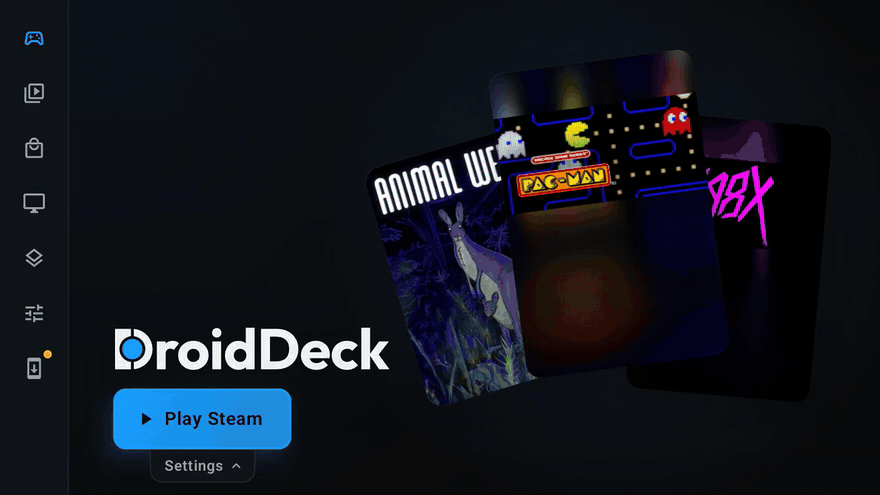
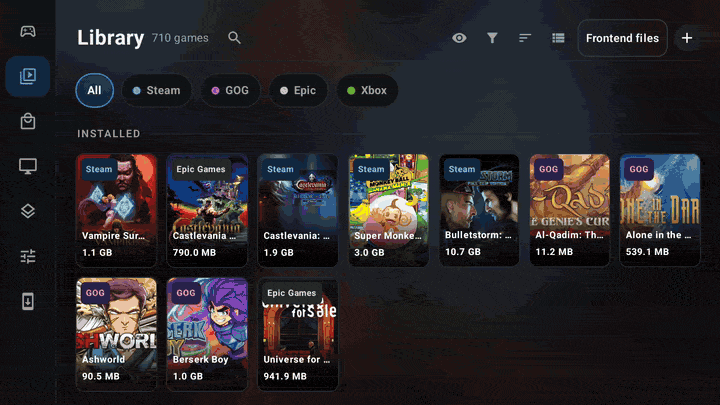
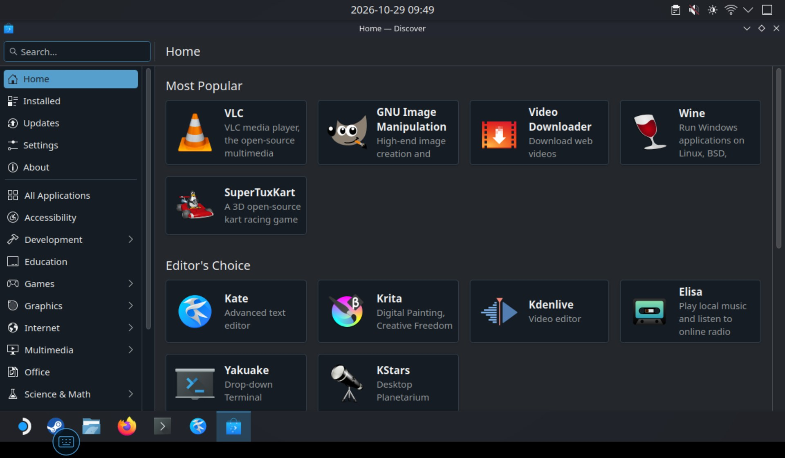

<p align="center">
  <picture>
    <source media="(prefers-color-scheme: dark)" srcset="artwork/droiddeck-banner-dark.svg">
    
  </picture>
</p>

<h3 align="center">DroidDeck-RE — Blazing Fast Performance, Rock-Solid Stability</h3>

DroidDeck brings the SteamOS experience to Android: Valve's Steam client in Big Picture on your Adreno handheld, with Windows games through Valve's ARM64 Proton. **DroidDeck-RE is the independent, stable release line of that project**: the same experience, plus everything below — maintained separately from upstream, with its own versioning starting at **1.0.0**.

> **Why this fork instead of upstream?** Upstream reviews at its own pace, so good work waits in open pull requests. This fork merges them instead of waiting: all 89 open upstream PRs are merged into `main` here, which in turn addresses some 17 open upstream issues (EA launcher installs, Ubisoft Connect launches, NTFS USB drives, DualSense support, 6+2 Oryon core pinning, per-game locales, Steam startup progress, Battle.net China installs, and others — see [docs/upstream-triage.md](docs/upstream-triage.md) for the per-item accounting). Remaining open issues are mostly game- or device-specific reports that need hardware to verify; they are triaged in the open, not silently closed. On top of the merged work this fork fixes what it finds (independent Steam client language, joydev rejection for SDL, shared exec cache) and keeps its own [changelog](docs/releases/) per release.

The APKs published here are test-key builds in [this fork's Releases](https://github.com/dwicao/DroidDeck/releases); upstream releases do not include these changes. Installs over previous RE releases keep app data.

<p align="center"><b>100% open source. No ads. No telemetry. No source withheld.</b></p>

<p align="center">
  <a href="https://github.com/Droid-Deck/DroidDeck/releases/download/0.6.7/DroidDeck-0.6.7.apk"></a>
  <a href="https://discord.gg/JRGAvawjsm"></a>
</p>

<p align="center">
  <a href="https://www.star-history.com/droid-deck/droiddeck"></a>
</p>

<p align="center">
  <a href="https://trendshift.io/repositories/267852"></a>
  <a href="https://trendshift.io/repositories/267852"></a>
</p>

<p align="center"></p>

> DroidDeck has no website. Only download it from this repository's [Releases](https://github.com/Droid-Deck/DroidDeck/releases).

<p align="center">
  
  
  
  
</p>

Use Android 9 or newer on a supported Adreno device (730 or newer, or 8xx). Adreno 6xx is experimental: DirectX 11 uses DXVK 2 and may run, and DirectX 12 games can still crash. Mali, Xclipse, PowerVR, and Adreno 710 are unsupported. No root is required. Allow about 3 GB for the runtime and 1.1 GB more for the desktop and emulators. Install the APK from [Releases](https://github.com/dwicao/DroidDeck/releases), install the Linux runtime, then press **Play** and sign in. Steam downloads on first launch. Install **Desktop & apps** to use the desktop and emulators. The **Store** installs Linux apps and games from Flathub (ARM64 builds) with Flatpak; with additional options to install Appimages and set up scripts. **Stores** (Setup › Stores › "Show Stores in the rail") signs in to GOG, Epic Games and Amazon Games and downloads games into the Games storage. Epic keeps its direct API install path. Opening Epic Stores prepares Epic’s official Linux launcher preview. When installed, Epic games launched from DroidDeck use that client, and games installed in the client are imported into DroidDeck’s library and shortcuts. The x86-64 client runs through FEX on ARM and DroidDeck retains its Proton hooks; this preview and ARM setup are outside Epic’s listed Linux support. The cog on a store’s chip row sets its opening tab and download speed tier.
## Install

1. Android 9 or newer on Adreno 730 or newer, or any 8xx. Adreno 6xx is experimental. Mali, Xclipse, PowerVR and Adreno 710 are unsupported. No root needed.
2. About 3 GB free for the runtime, plus 1.1 GB for the desktop and emulators.
3. Install the [APK](https://github.com/Droid-Deck/DroidDeck/releases/download/0.6.7/DroidDeck-0.6.7.apk), install the Linux runtime, press **Play** and sign in to Steam.
4. On Android 14 and newer, turn on **Disable child process restrictions** in Developer options. On Android 12 and 13, Steam's first launch shows a **Fix it for me** button that walks you through it.

## Play from any storage

DroidDeck does not tie your games to internal storage. **Setup > Storage** can keep them on:

- **Internal storage**, the fastest path.
- **SD card** storage that Android exposes to apps.
- **A USB drive or SSD**, including drives Android does not report as app-specific external storage.
- **Any writable folder** through **Choose folder…**; DroidDeck creates a `Games` folder inside it.

**Default storage** applies to new store installs and the Epic Games Launcher, while each Steam library keeps its own **Game storage** choice. Games that are already installed do not have to stay put: **Setup > Storage > Games > Move** moves a Steam game, its Proton prefix, shader cache, workshop content, pending downloads, and manifest into internal storage, the SD card, a configured games folder, or a picked folder. The destination is registered as a Steam library, so Steam keeps detecting and launching the game, and a failed copy puts the files back. Stop the session first; moves can be cancelled from the progress dialog, and an interrupted move is reported on the Storage page with a one-tap discard of the partial copy.
- Games added with **Games > Add a game** are listed with their full size under **Added games** and have their own **Move**. Their folder, picked exe, prefix record, and library entry move together.
- If an added folder matches a Steam game whose install folder is missing, **Install into Steam** moves it into that library's `steamapps/common` folder and Steam adopts it on its next start. Pick the game yourself when it is not matched automatically.
- Doing it by hand works too: copy the game folder into the library's `steamapps/common/<installDir>` yourself, press **Install** in Steam, and Steam verifies the existing files instead of downloading them again.

If a chosen folder is disconnected, DroidDeck asks for a target instead of silently falling back to internal storage. Plugged-in USB drives appear in the file and folder pickers; if a drive is visible but not readable, grant DroidDeck **All files access** when asked.

## Physical button shortcuts

Open the launcher's **Controls** settings, **Setup → Controller → Button mapping**, or the session drawer's **Controller** page. Each menu action has one row showing **Custom** or **Default**. Select the current value beside **Steam menu**, **Open Quick Access Menu**, or **DroidDeck menu**, then press and release a physical button. The assignment saves automatically on release; confirmation is only required if the button already opens another menu. Assignments are stored per controller; each action has one assigned button per controller. A mapped button performs the shortcut instead of sending its normal input to the game. Steam shortcuts only apply in Steam sessions, and shortcuts are inactive while loading, suspended, or using the on-screen keyboard or other input dialogs.

Unassigned buttons keep their existing behavior, including the Back button's single/double-press setting and Select-to-Steam option. While the session drawer is open, A selects the focused item even if it has a shortcut assignment. Select an action's current value and use **Reset** beside an assignment to restore that behavior without changing touch layouts or other controller settings. **Close** exits capture without changing an assignment; it does not undo an assignment already applied. The touchscreen remains available for configuration and recovery.

Extra buttons such as M1/M2 work only if Android exposes distinct key events to the app. Android Home, volume and other reserved system keys cannot be assigned; making DroidDeck the default launcher retains its existing Home-to-Steam behavior. Firmware that intercepts a button or makes it duplicate another button cannot be overridden here. During capture, the detected device and button name are shown. If a controller disconnects before release, use **Try another button** to restart capture; **Reset** remains available for existing assignments. Capture and shortcut-action diagnostics, including key and scan codes, are included in session logs when capture runs inside a session. If a button is not detected, record its physical label, firmware/controller mode, and whether it leaves the app, then share the session logs.

## Smart glasses

Use **Setup → Smart glasses** for app-wide virtual-screen settings across DroidDeck menus, launchers, desktop sessions, and games. Supported VITURE, RayNeo, XREAL, and Rokid connections provide 3DoF; Luma Ultra adds optional experimental 6DoF and stereo-assisted hand/Joy-Con tracking. Model support and SDK requirements differ: see the [smart-glasses support matrix](docs/smart-glasses-support.md) for supported devices, controls, setup, and limitations.

## Performance and thermals

The **Performance** page can hold the GPU at the top level the platform allows. **Thermal guard** is
off by default: when enabled, it releases that hold as the thermal headroom reaches the limit and
restores it after the device cools, trading the top clock for a softer landing instead of letting
the platform drop straight to its floor. Neither setting can raise a level the platform's thermal
engine has already taken away.

On Samsung devices the vendor game policy also applies. Set **Gaming Hub → ⋮ → Game Booster → Game
optimisation → Performance**; `device.txt` reports the active `Game Mode` and the hottest thermal
zone. On an SM-F946B running NSUNS4 at 1280x720, 0.4.11 held 30 FPS (60 with LSFG 2x) at moderate
thermal, mostly at 475 MHz with occasional 295 MHz. A cooler mount and a charger with headroom
remain the reliable ways to keep a higher ceiling.

When a session ends cleanly but `perf.csv` shows the GPU ceiling falling while the pin was held
(e.g. 719→348 MHz with `thermal=none`), the ended screen now says so directly: the kernel thermal
engine follows per-cluster CPU sensors, not the averages, so a cool GPU average does not rule it
out. Past Game Booster and cooling, holding back the platform limit needs system-level privilege
the launcher does not have; advanced users do it with Shizuku-based tools such as
[Muimex11](https://github.com/Inkflow-Gab/Muimex11) (thermal override + GOS removal), at their own
risk.
## What upstream proposed, already merged here

Upstream's open backlog is merged into this fork instead of waiting for review. Concretely, `main` here contains all 89 upstream pull requests that were open at the time of the merge: the EA Games launcher installer, Ubisoft Connect launches, NTFS USB drives without root, full DualSense support (lightbar, triggers, touchpad, gyro calibration), foldable and half-folded deck controls, per-component update mirrors, per-game locales, Steam startup progress reporting, Battle.net China installs, the 6+2 Oryon core plan, Kishi/USB rumble, the accessibility tab with Orca, and the rest — each kept as its own merge commit so the history stays reviewable. Where two PRs solved the same problem differently (per-game core pinning, completed Steam language rows in Arabic), the documented perf rationale wins and the losing test is updated with a pointer, not silently dropped.

That merge wave resolves open upstream issues outright (the accessibility tab in #553, GOG maintenance in #680, the "follow screen" divisor in #1640, desktop Chinese support in #210 and #992, Steam startup progress in #812, Fold 7 throttling in #779) and carries the proposed fixes for more (EA + Ubisoft support in #1631, Xwayland stalls in #1123, Battle.net China installs in #1659, Quest 3 gamescope aborts in #1792, per-game relative mouse in #845, keyboard mapping in #567), among others. Issue reports that are game- or device-specific stay open until someone can reproduce them on hardware; nothing is closed to inflate numbers.

On top of the merged work, this fork carries its own fixes: an independent Steam client language selector (Steam no longer forced to the launcher language, #708), restored joydev rejection so SDL reads real gamepad IDs, a shared exec cache for relocated Wine code, and a hard-coded-English audit of new UI copy. The APKs below are test-key signed CI builds of exactly this tree.

## What RE adds

Everything below ships in **1.0.0 (40)** and is independent of upstream releases (see the note at the top). Release notes with APKs live on the [Releases page](https://github.com/dwicao/DroidDeck/releases).

### Session pacing, GPU, and thermals

- Guest pacing follows the panel's real refresh rate instead of the UI thread's vsync average, so
  DeX sessions do not drift below the panel when the phone's screen sleeps. LSFG derives the guest's
  base rate from the panel and multiplier, a display rate is snapped to a mode the panel actually
  has, and a chosen limit that cannot land on the panel is reported instead of silently changed.
- `perf.csv` is sampled every two seconds with each cluster's clock against the platform ceiling,
  the GPU clock/floor/load/power level/temperature, thermal status and headroom, online mask,
  memory, battery current/power/temperature, and the hottest thermal zone. `device.txt` gains the
  paced numbers and a pacing block on every plan change, including at the end of the session.
- The GPU pin is on by default, re-asserts through the session, and cycles KGSL's `PWRCTRL` when the
  platform lifts a clamp, so a clock left at 475 MHz while the ceiling is back at 719 MHz is taken
  back. The report names the lever, the platform level, and why the level node refused a write.
- The SM8550/QCS8550 default core set no longer keeps the prime core away from games: the client
  keeps core 7 and the game may share it.
- **Thermal guard** is opt-in (Performance -> GPU). It releases the pin at 0.89 headroom once the
  framework is at LIGHT, and restores it at 0.82 after at least eight seconds. Reports also carry
  the active Game Mode, hottest zone, battery current/power, and guard state. The first 1280x720
  field session on 0.4.11 held a stable 30 FPS base and 60 FPS with LSFG at MODERATE thermal, mostly
  at 475 MHz with occasional 295 MHz.

### x86 Linux games and Steam sessions

- x86-64 titles work through FEX with Steam Linux Runtime 3.0 on both `sniper_platform_*` and
  `soldier_platform_*` layouts. RootFS is prepared every Steam session, and Valve's
  `fex-compat-tool` is supported as well as DroidDeck's wrapper.
- x86 Linux titles register a `droiddeck-x86` mapping that drops `GLIBC_TUNABLES`, avoiding the
  glibc `sbrk()` abort under FEX. **Components > FEX > x86 Linux titles** chooses Steam FEX or
  DroidDeck FEX and can enable FEX logging.
- Setup names missing FEX/runtime depots and offers to install them. A stray Steam client from a
  session that did not shut down is reaped before the next launch, so the new session does not
  forward its arguments to the old client and exit.
- Imported installs finish stalled staged updates, carry DepotDownloader configuration, and search
  by normalized folder names or the game's own `steam_emu.ini` when the store listing spelling
  differs. Import fingerprints tolerate snapshots recorded before `steam_id` was added.

### Game kits, installs, and launch diagnostics

- Game kit export/import packages a Steam install with its manifest and `InstalledDepots` as a
  `tar.zst` archive, and writes the manifest last on import so Steam adopts the copied install
  without downloading it again. **Export kit** is a per-game button; import is under **Setup >
  Storage > Steam games**.
- Each game launch writes `games/<app id>.log` with the command, prefix, install folder,
  environment, Proton/Wine/Unity output, exit timing, Player/crash logs, and a module report that
  flags patched or shadowing Steam DLLs. Per-game environment switches are `DROIDDECK_SYNC=off`,
  `DROIDDECK_AUDIO=off`, `DROIDDECK_VERBOSE=1`, and `DROIDDECK_RESET_PREFIX=1`.
- A launch that stops early is measured against its manifest and, for Unity Addressables titles,
  its catalog; a short install is named with the missing bundle count instead of looking like a game
  that simply exited.
- A failed session is matched against known failure signatures and offers a one-tap fix-and-run
  (**Launch Doctor**): UE5 mesh-shader crashes pin the game to `VKD3D_FEATURE_LEVEL 12_1`, failed
  Steam client downloads or setup re-run on retry. A fix applied twice without recovery stops being
  offered, and every diagnosis is appended to `launch-doctor.log` as one JSON line.

### Storage

- **Setup > Storage > Default storage** chooses where new store installs go: **Internal storage**,
  **External storage**, **Choose folder…**, or **Ask every time**. The folder picker can target any
  writable folder, including an SSD or USB drive that Android does not expose as an app-specific
  external directory. The Epic Games Launcher uses the same choice for its install directory.
- **Move** on an installed Steam game moves it to internal storage, the card, a configured games
  folder, or a picked folder. The game's files, Proton prefix, shader cache, workshop content,
  pending downloads, and manifest move together; the destination is registered as a Steam library
  for the right client, and a failed copy is rolled back. Moves are blocked while a session runs and
  while storage cleanup is active.
- **Move** on an added game moves its whole folder; exe, prefix record, and library entry follow it.
  **Install into Steam** adopts a matching folder into that library's `steamapps/common` folder so
  Steam detects the game on its next start. Doing it by hand works too: copy the folder there
  yourself and press **Install** in Steam, which verifies the files instead of downloading them.
- Existing games are not moved automatically; use **Move** to relocate one. Steam libraries keep
  their own **Game storage** setting. If the selected folder is disconnected, DroidDeck asks for a
  target instead of silently using internal storage.

### Release engineering

- CI hosts the Debian bullseye image used by the preload build from a release rather than Docker Hub,
  avoiding the rate limit that failed the build.
- Documentation and tests in the range cover the pacing table, GPU ceiling, chosen-limit note,
  short-install record, and the 0.4.11 field session.

### 1.0.0: universal compatibility and stability

- **Built-in per-game environment defaults** (`droiddeck-game-env`): Naruto Storm 4 gets a
  locked 30 FPS base plus async pipeline compilation; user settings always win.
- **Safer graphics defaults**: `VKD3D_FEATURE_LEVEL` 12_2 → 12_1 (UE5 mesh-shader crashes).
- **Idle-friendly Steam home**: the floating capsule fan plays once on appearance instead of
  recomposing forever (~2.4k frames per 10 s idle).
- **Working Browse buttons**: backported upstream Steam file-dialog fixes.
- **GOG cloud saves at the location root** (with old-layout migration), Steam client CDN probing
  with resume handover, Xbox sign-in diagnostics, Ubisoft-via-Connect launch, shared games between
  arm64 and x86-64 clients, experimental external-display output, and an HTTP proxy option —
  all ported non-breaking upstream PRs, tracked in [docs/upstream-triage.md](docs/upstream-triage.md).

<details>
<summary><strong>Full history</strong></summary>

Every fork change ships in a dated release with notes under [`docs/releases/`](docs/releases/) — see the [Releases page](https://github.com/dwicao/DroidDeck/releases) for the APKs. The commit history stays linear and reviewable; upstream work taken in is listed per item in [docs/upstream-triage.md](docs/upstream-triage.md).
</details>

## Community

Join the [DroidDeck Discord](https://discord.gg/JRGAvawjsm) for help, Preview builds, and device reports. Bug reports go in its **#bug-reports** forum; attach the zip from **Share logs** (Setup, or the session drawer) so the logs come with it.

## Build

Needs Docker, Java 17, the Android SDK and NDK, Rust via rustup, GitHub CLI, Python 3 and `zstd`.

```bash
tools/build_local.sh
```

The APK lands in `app/build/outputs/apk/release/`. Install it with `tools/deploy_local.sh`. After the first run, `./gradlew :app:assembleRelease` reuses the prepared inputs. Unit tests run with `./gradlew -PskipRust=true :app:testDebugUnitTest`, and the helper and preload suite with `bash tools/test_local.sh`.

On Windows, see `tools/run_windows.ps1` and `tools/prepare_windows_runtime.py`.

## Limits

Compatibility and performance vary by device. Desktop compositing is software rendered, and Firefox sandboxing is reduced under proot.

## Credits and licence

DroidDeck is [GPL-3.0](LICENSE). Steam and Proton belong to Valve Corporation. VITURE, RayNeo, XREAL, Rokid, REDMAGIC, Nintendo Switch and Joy-Con are trademarks of their owners. This project is not affiliated with any of them.

<details>
<summary><b>Runtime, Wine and Proton</b></summary>

- Runtime, shim, input and controller work build on WinNative and Bannerlator by maxjivi05.
- mmap ring buffer controller input by ribbit384 ([WinNative #345](https://github.com/WinNative-Emu/WinNative/pull/345)).
- [FEX](https://github.com/FEX-Emu/FEX) (MIT) runs x86 code. DroidDeck's build puts the platform name under `AT_PLATFORM` so [sharun](https://github.com/VHSgunzo/sharun) AppImages by VHSgunzo (MIT) start through its [userland-execve](https://crates.io/crates/userland-execve) loader (MIT). FEX's code disk cache was checked in its source.
- x86 AppImages, and arm64 ones whose runtime can't unpack on Android, are unpacked with [uruntime](https://github.com/VHSgunzo/uruntime) by VHSgunzo (MIT), shipped unmodified with its licence.
- x86 programs linking OpenSSL 3 use the copy in the [Steam Linux Runtime 4.0](https://gitlab.steamos.cloud/steamrt/steamrt). x86 Linux games get the `/etc/asound.conf` that [pressure-vessel](https://gitlab.steamos.cloud/steamrt/steam-runtime-tools) writes.
- `WriteProcessMemory` hooks fall back to `/proc/<pid>/mem` the way [Wine](https://gitlab.winehq.org/wine/wine)'s `server/ptrace.c` did before Wine 11.
- Wine write watches use userfaultfd support in [Proton](https://github.com/ValveSoftware/wine)'s `dlls/ntdll/unix/virtual.c` (LGPL-2.1-or-later). libblsession supplies the arm64 syscall number and answers `PAGEMAP_SCAN` from `/proc/self/pagemap`.
- libblsession runs Wine's arm64 `SIGUSR2` context handler (`dlls/ntdll/unix/signal_arm64.c`, LGPL-2.1-or-later) in place on a frame laid out like [Linux](https://github.com/torvalds/linux)'s `arch/arm64/kernel/signal.c`, and serves `fill_vm_counters` in `dlls/ntdll/unix/process.c` the kernel's own `/proc/<pid>/status`.
- droiddeck-ntsync follows the [Linux](https://github.com/torvalds/linux) ntsync semantics in `Documentation/userspace-api/ntsync.rst` (GPL-2.0).
- The proot fast path orders bindings like [PRoot](https://github.com/proot-me/proot)'s `path/binding.c` (GPL-2.0-or-later).
- Games use [Mesa](https://gitlab.freedesktop.org/mesa/mesa) Turnip's per render pass memory choice. The Steam client keeps `TU_DEBUG=sysmem`.
- Black Ops III and Dark Souls Remastered start without [umu-protonfixes](https://github.com/Open-Wine-Components/umu-protonfixes) (BSD-2-Clause), whose `311210.py` and `570940.py` fail under ARM64 Proton.
- [ReSkate](https://github.com/Dingo-Shenanigans/ReSkate) (GPL-3.0) by Dingo Shenanigans uses the launch option from its README and D3D12 feature level 12_1.
- The arm64 client's sign in was checked by reading Steam's saved token with the `ConnectCache` format from [deadlock-api-ingest](https://github.com/deadlock-api/deadlock-api-ingest).

</details>

<details>
<summary><b>Stores</b></summary>

- Epic Games and GOG build on [Phobos](https://github.com/phobos665)'s adaptation of [Legendary](https://github.com/legendary-gl/legendary) and [gogdl](https://github.com/Heroic-Games-Launcher/heroic-gogdl). GOG install script registry entries are read the way [Heroic Games Launcher](https://github.com/Heroic-Games-Launcher/HeroicGamesLauncher) (GPL-3.0) reads them.
- Epic's official Linux launcher preview runs through FEX. That setup is outside Epic's listed Linux support.
- Battle.net is by [@kayakyakr](https://github.com/kayakyakr). It runs Blizzard's own client in Proton (downloaded from Blizzard, not included) and shows key art from the [Battle.net Shop](https://shop.battle.net). Without Steam, its games see the pad as an Xbox 360 controller via `PROTON_SPOOF_STEAMINPUT_VIDPID` in [Proton](https://github.com/ValveSoftware/wine)'s `dlls/winebus.sys`.
- Battle.net installs drive Blizzard's Agent the way [@barncastle](https://github.com/barncastle)'s [Battle.Net-Installer](https://github.com/barncastle/Battle.Net-Installer) does, with requests from [wowdev.wiki](https://wowdev.wiki/Agent). Read without taking code: [@mubaraknumann](https://github.com/mubaraknumann)'s [unifideck](https://github.com/mubaraknumann/unifideck), [@djmittens](https://github.com/djmittens)'s [neo-mittens](https://github.com/djmittens/neo-mittens) `bnetswitch`, [@BCD1210](https://github.com/BCD1210)'s [soju](https://github.com/BCD1210/soju) and [Lutris](https://github.com/lutris/lutris)'s `product.db` reader.
- Xbox games load [@domsvoboda](https://github.com/domsvoboda)'s [xodus-nexus](https://github.com/domsvoboda/xodus-nexus) modules (LGPL-2.1-or-later), including `wintypes.dll`. Minecraft's GameInput setup was checked against [@Wyze3306](https://github.com/Wyze3306)'s [BedrockOnLinux](https://github.com/Wyze3306/BedrockOnLinux) (MIT).
- The itch.io butler pack ships butler's `7z.so`, itch.io's build of [7-Zip](https://www.7-zip.org) by Igor Pavlov (LGPL-2.1, unRAR restriction on RAR code), unmodified. Other archives use Apache Commons Compress and the runtime's bsdtar (libarchive).
- The Store uses [Flatpak](https://github.com/flatpak/flatpak) (LGPL-2.1) through DroidDeck's own bubblewrap shim. Chromium and Electron apps start directly, since [zypak](https://github.com/refi64/zypak) by [@refi64](https://github.com/refi64) (BSD-3-Clause) always uses Flatpak's spawn portal.

</details>

<details>
<summary><b>Audio, video and HUD</b></summary>

- Steam audio goes through [@The412Banner](https://github.com/The412Banner)'s [DirectAudio](https://github.com/The412Banner/directaudio) PulseAudio sink (LGPL-2.1-or-later), built from `tools/directaudio/sink`.
- The DroidDeck HUD is [@The412Banner](https://github.com/The412Banner)'s [FusionHUD](https://github.com/The412Banner/FusionHUD) (GPL-3.0 with an attribution term). Its readings match Valve's [MangoHud](https://github.com/flightlessmango/MangoHud) build (MIT), with frame times from gamescope patch 0125.
- LSFG frame generation comes from Camille LaVey and the [Eden](https://eden-emu.dev) project, following [lsfg-vk](https://github.com/PancakeTAS/lsfg-vk), ported by [@maxjivi05](https://github.com/maxjivi05). It needs your own copy of [Lossless Scaling](https://store.steampowered.com/app/993090/) and ships none of its shaders.
- Remote Play decodes through Android's MediaCodec or the [FFmpeg](https://ffmpeg.org) (LGPL-2.1-or-later) in Steam's runtime. Qualcomm low latency settings follow [Moonlight](https://github.com/moonlight-stream/moonlight-android) (GPL-3.0).
- [PipeWire](https://gitlab.freedesktop.org/pipewire/pipewire) (MIT) sockets use the settings in its `module-access.c`, and [WirePlumber](https://gitlab.freedesktop.org/pipewire/wireplumber) (MIT) keeps those clients at full permissions.

</details>

<details>
<summary><b>Desktop</b></summary>

- The KDE pacman repository snapshots [Arch Linux ARM](https://archlinuxarm.org) and installs with [pacman](https://gitlab.archlinux.org/pacman/pacman) (GPL-2.0-or-later).
- [KWin](https://invent.kde.org/plasma/kwin) (GPL-2.0-or-later) is patched to pass on the scroll data its `wayland_backend.cpp` leaves as a TODO.
- Read without taking code: [Qt](https://code.qt.io/cgit/qt/qtbase.git)'s `qwaylandinputdevice.cpp` and `qguiapplication.cpp`, [Konsole](https://invent.kde.org/utilities/konsole)'s `TerminalDisplay.cpp`, and [Mesa](https://gitlab.freedesktop.org/mesa/mesa)'s `u_threaded_context.c` and `zink_resource.c`.
- The Steam Keyboard window rule follows Valve's `steamdeck-kde-presets` with [Bazzite](https://github.com/ublue-os/bazzite)'s `0001-steam-virtual-keyboard.patch`.
- Steam's Browse buttons open a GTK 3 file chooser via PyGObject (LGPL-2.1-or-later), shown over Steam by [gamescope](https://github.com/ValveSoftware/gamescope) (BSD-2-Clause) through `GetAppIdFromReaper`.
- The AYN Odin 2 phantom second display was confirmed by [@SapphireRhodonite](https://github.com/SapphireRhodonite)'s [WatermelonDS 0.0.5](https://github.com/SapphireRhodonite/WatermelonDS/releases/tag/0.0.5) notes and [iiSU #363](https://github.com/iisu-network/iiSU/issues/363), without taking their code.

</details>

<details>
<summary><b>Smart glasses</b></summary>

- Builds on WinNative's VITURE work. Protocol checked against [@wheaney](https://github.com/wheaney)'s [XRLinuxDriver](https://github.com/wheaney/XRLinuxDriver), [@badicsalex](https://github.com/badicsalex)'s [ar-drivers-rs](https://github.com/badicsalex/ar-drivers-rs) and [go-macos/iokit](https://pkg.go.dev/github.com/go-macos/iokit/viture). The optional VITURE SDK is not included.
- RayNeo adapts [@informalTechCode](https://github.com/informalTechCode)'s [RayNeo-Air-Series-3DoF-Scaffold](https://github.com/informalTechCode/RayNeo-Air-Series-3DoF-Scaffold) (Apache-2.0) and references [@verncat](https://github.com/verncat)'s [RayNeo-Air-3S-Pro-OpenVR](https://github.com/verncat/RayNeo-Air-3S-Pro-OpenVR) (MIT) and [Monado](https://gitlab.freedesktop.org/monado/monado) (BSL-1.0). See [docs/third-party/rayneo](docs/third-party/rayneo/README.md).
- XREAL 1S references XRLinuxDriver and [xrealOneDeviceKit](https://github.com/wheaney/xrealOneDeviceKit) by @wheaney, [@rohitsangwan01](https://github.com/rohitsangwan01)'s [xreal_one_driver](https://github.com/rohitsangwan01/xreal_one_driver) (MIT) and [@0xcaff](https://github.com/0xcaff)'s [xr-tools](https://github.com/0xcaff/xr-tools).
- Rokid follows ar-drivers-rs, @badicsalex's [Void Computing write-ups](https://voidcomputing.hu/blog/worse-better-prettier/) and Monado's Rokid driver.
- REDMAGIC display findings draw on [@mekhontsev](https://github.com/mekhontsev)'s [MagicDesk investigation](https://github.com/mekhontsev/magicdesk/blob/main/docs/xr-resolution-fix.md) and [@Coding-BR](https://github.com/Coding-BR)'s [decompiled Nubia kernel](https://github.com/Coding-BR/android_kernel_nubia_sm8850_qwjujube).

</details>

<details>
<summary><b>VR, Joy-Con and hand tracking</b></summary>

- Joy-Con VR ports the arm model from Google's [GVR SDK for Unity](https://github.com/googlevr/gvr-unity-sdk) (Apache-2.0) and adapts the hand skeleton from Valve's [OpenVR](https://github.com/ValveSoftware/openvr) `handskeletonsimulation` sample (BSD-3-Clause), which follows Moshi Turner's work in Monado. Index offsets come from Monado's `vive_poses.c` (BSL-1.0).
- Joy-Con research: Linux's [hid-nintendo](https://github.com/torvalds/linux/blob/master/drivers/hid/hid-nintendo.c) by Daniel J. Ogorchock, [@dekuNukem](https://github.com/dekuNukem)'s [Nintendo_Switch_Reverse_Engineering](https://github.com/dekuNukem/Nintendo_Switch_Reverse_Engineering), [SDL](https://github.com/libsdl-org/SDL) and AOSP. Checked against [ALVR](https://github.com/alvr-org/ALVR), [OpenComposite](https://gitlab.com/znixian/OpenOVR), [PSMoveSteamVRBridge](https://github.com/HipsterSloth/PSMoveSteamVRBridge), [@F8LEFT](https://github.com/F8LEFT)'s [JoyConVr](https://github.com/F8LEFT/JoyConVr), [@krnelpan1c](https://github.com/krnelpan1c)'s [Daydream-Controller-SteamVR](https://github.com/krnelpan1c/Daydream-Controller-SteamVR), [@yoyobuae](https://github.com/yoyobuae)'s [joyconvr](https://github.com/yoyobuae/joyconvr), [Moonlight](https://github.com/moonlight-stream/moonlight-android) and [Dolphin](https://github.com/dolphin-emu/dolphin). See [docs/third-party/joycon](docs/third-party/joycon/README.md).
- Camera hand tracking runs Google's [MediaPipe](https://github.com/google-ai-edge/mediapipe) Pose Landmarker (Lite), BlazePose GHUM 3D and Hand Landmarker (Apache-2.0) on [CameraX](https://developer.android.com/jetpack/androidx/releases/camera) frames (Apache-2.0), with usage reports off. Checked against JoyConVr's camera app (MIT).
- Tracking math: the GVR arm model's accelerometer mode, Eric Foxlin's zero velocity updates, Frosio, Pedersini and Borghese's accelerometer autocalibration, a Kalman filter (Kalman, 1960), Horn's quaternion method (1987) and the 1€ filter (Casiez, Roussel and Vogel, 2012).
- Gestures follow [ALVR](https://github.com/alvr-org/ALVR)'s `hand_gestures.rs` (MIT) and Meta Quest's menu pinch, tuned on [HaGRID](https://github.com/hukenovs/hagrid) photos (CC BY-SA 4.0, not included).
- The glove model follows OpenVR's render model reference, is meshed with surface nets (Gibson, 1998; Mikola Lysenko), and uses Inigo Quilez's smooth minimum, distance field ambient occlusion and polygon distance (MIT). See [docs/third-party/handtracking](docs/third-party/handtracking/README.md).

</details>

## Star history

<a href="https://www.star-history.com/#Droid-Deck/DroidDeck&Date">
  <picture>
    <source media="(prefers-color-scheme: dark)" srcset="https://api.star-history.com/svg?repos=Droid-Deck/DroidDeck&type=Date&theme=dark">
    
  </picture>
</a>
